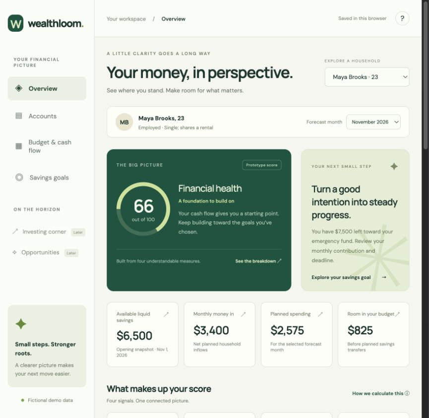
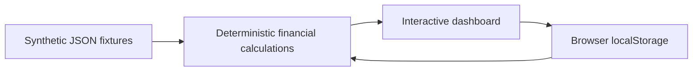

# Wealthloom

**A clearer picture of household financial health.**

Wealthloom is a learning project that turns household financial inputs into an understandable dashboard: savings goals, cash flow, account balances, shared expenses, and a transparent Financial Health score.

The current version is a working, browser-based prototype with **five fictional households**. It does not connect to financial accounts, use real customer data, or execute transactions.



## What works today

- Switch between five personas with different household and financial circumstances.
- Explore a custom **0–100 Financial Health score** and its component definitions.
- Review account balances with institution branding, ownership, and cash-availability flags.
- Edit income, planned expenses, balances, savings goals, and cash-buffer targets.
- Recalculate scores and cash-flow summaries immediately after an edit.
- View household expense responsibilities and a small sample of historical payments.
- Save demo edits in the current browser and reset one household independently.
- Compare monthly budget scenarios and inspect supporting cash-coverage/runway analysis.

## Run locally

Requirements: Node.js 20 or newer for tests; Python 3 for the example static server. The application has no package dependencies or build step.

```sh
git clone https://github.com/tejaseelam/wealthloom.git
cd wealthloom
node test.mjs
python3 -m http.server 4173 --directory dist
```

Open [localhost:4173](http://localhost:4173). Serve the files over HTTP rather than opening `index.html` directly, because the application loads its JSON fixture with `fetch`.

Any static host can serve `dist/`. This repository does not contain account-specific hosting IDs or credentials. The existing hosted prototype has owner-only access; hosting the source does not make that instance public.

## How the score works

| Component | Weight | Prototype definition |
| --- | --- | --- |
| Savings-goal progress | 30% | Allocated amount ÷ selected target, capped at 100% |
| Cash buffer | 30% | Available cash ÷ (recurring essential monthly costs × selected buffer months), capped at 100% |
| Cash flow | 30% | Monthly surplus ÷ cash inflows ÷ 20%, bounded to 0–100 |
| Income diversity | 10% | `min(1, 2 × (1 − sum(source_share²))) × 100` |

The final weighted score is rounded once. Multiple deposits from one income source remain grouped. Retirement withdrawals count as cash inflows but not as independent earned-income sources. Missing supported prerequisites make the score unavailable.

These weights and reference points are **authored prototype heuristics**, not validated financial guidance, a credit score, or the CFPB Financial Well-Being Scale. The score does not assess every aspect of someone's financial situation. All calculations are deterministic JavaScript; GPT does not generate score values.

## Architecture



| File | Responsibility |
| --- | --- |
| `dist/index.html` | Dashboard structure and dialogs |
| `dist/styles.css` | Responsive presentation |
| `dist/app.mjs` | Persona selection, rendering, editing, and browser persistence |
| `dist/finance.mjs` | Monthly normalization, component metrics, and scoring |
| `dist/demo-data.json` | Fictional households, accounts, income, budgets, payments, and goals |
| `test.mjs` | Calculation and dataset checks using Node's built-in assertions |

## Current limitations

- Edits are local to one browser; there is no backend database or cross-device synchronization.
- Future-month views reuse the opening November 2026 savings snapshot. They are **budget scenarios, not a rolling cash forecast**.
- Weekly, biweekly, and annual flows use monthly equivalents; partial months are not prorated.
- Spreadsheet ingestion and full intake forms are not implemented.
- The seed and calculation functions are a prototype input contract, not production-grade validation for arbitrary uploaded data.
- There are no live financial APIs, GPT agents, investment recommendations, or business-listing feeds yet.
- Income-source counts do not establish independence or reliability; the app surfaces relevant uncertainty.

## Progress and documentation

- [Product requirements](docs/PRD.md): public, sanitized requirements and roadmap.
- [Progress so far](docs/PROGRESS.md): delivered work, verification, and next milestones.
- [Data and privacy](docs/DATA_AND_PRIVACY.md): fixture provenance and real-data boundaries.
- [Third-party assets](docs/THIRD_PARTY_ASSETS.md): institution icons and font sources.

The first release focuses on household budgeting and Financial Health. Later phases explore a validated ingestion pipeline, a free database option such as MongoDB, rolling forecasts, and evidence-backed insights. Investing, tax/healthcare savings, and business opportunities are later product areas.

## Learning focus

The project develops practical skills in requirements, data modeling, pipeline design, analytics, testing, GPT integration, and agent evaluation. The baseline deliberately calculates financial metrics in ordinary code before introducing language-model explanations or multiple agents.

## Data boundaries

Only authored synthetic household data belongs in this repository. Keep private spreadsheets, personal profiles, exported reports, credentials, and private database backups outside the repository. Institution names identify illustrative providers; they do not imply account connections or endorsement. No code license has been selected yet; third-party assets retain their respective rights.
